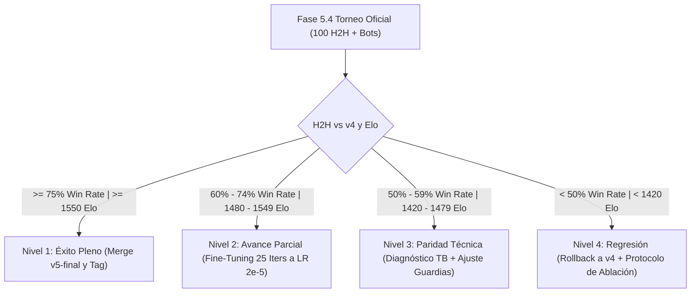

# Plan de Contingencia, Diagnóstico y Mitigación de Truncamiento en OpenRA-RL v5

Este documento define el protocolo operativo en caso de no alcanzar los objetivos previstos ($\ge 1550$ Elo y $\ge 75\%$ H2H vs `v4-champion`), los métodos de diagnóstico en tiempo real mediante TensorBoard, y las estrategias de ingeniería para mitigar partidas incompletas/truncadas al introducir mapas de mayor escala territorial como `doubles.oramap`.

---

## 1. Salvaguardas Automáticas (Cero Regresión)

1. **Invarianza del Campeón v4:** `runs/v4/selfplay/checkpoint_best.pt` y `runs/v5/warmstart/model.pt` permanecen congelados en disco. Ningún modelo v5 sustituye al bot desplegable en producción/escaramuzas hasta que supere a v4 con significancia estadística ($p < 0.01$).
2. **Selección Monotónica en Liga:** En `ra_rl/selfplay.py`, `checkpoint_best.pt` solo se actualiza si el *Composite Score* (media armónica contra bots + vs BC) supera estrictamente el máximo histórico previo.

---

## 2. Matriz de Decisión según Resultados

| Nivel de Resultado | Diagnóstico | Acción Operativa Inmediata |
| :--- | :--- | :--- |
| **Nivel 1: Éxito Pleno** ($\text{H2H} \ge 75\%$, $\text{Elo} \ge 1550$) | La atención espacial Transformer y el destacamento `SPECOPS` desbloquearon el macro-juego y las unidades Tier 3. | Merge a `v5-final`, exportación a ONNX y cierre del sprint. |
| **Nivel 2: Avance Parcial** ($\text{H2H } 60\% - 74\%$, $\text{Elo } 1480 - 1549$) | El agente es superior a v4, pero la mayor capacidad de la red (Transformer + 2 nuevas cabezas) necesitó más tiempo para estabilizar la varianza. | **Fine-tuning corto (25 iteraciones adicionales):** Se relanza `selfplay` arrancando desde `runs/v5/selfplay/checkpoint_best.pt` con learning rate reducido ($2 \times 10^{-5}$) y `kl_prod_min = 0.002`. |
| **Nivel 3: Paridad Técnica** ($\text{H2H } 50\% - 59\%$, $\text{Elo } 1420 - 1479$) | El agente aprendió a jugar en el mapa nuevo (`doubles`), pero descuidó agresividad en combate cerrado (`singles`), o experimentó sobrecostos económicos. | Se aplica el árbol de diagnóstico de TensorBoard (Sección 3) y se ajustan las guardias económicas. |
| **Nivel 4: Regresión** ($\text{H2H} < 50\%$) | La exploración de habilidades o macro causó fugas de créditos o el crítico asimétrico no convergió. | Se mantiene `v4` en producción y se ejecuta el protocolo de ablación (Sección 4). |

---

## 3. Árbol de Diagnóstico por Telemetría (TensorBoard)

Al abrir TensorBoard (`tensorboard --logdir runs/v5`), revisamos 4 señales determinantes:

### Señal A: Hambruna Económica por Techeo Prematuro (*Economic Starvation*)
* **Métrica a mirar:** `behavior/veh_harv_pct` y `loss/pi_prod`.
* **Síntoma:** Si `behavior/veh_harv_pct` cayó por debajo del 12% mientras aumentaban `ctnk` o `qtnk`, el agente retrasó su 2ª y 3ª cosechadora para techear.
* **Remediación:** Endurecer la guardia económica en `ra_rl/features.py`:
  $$\text{Créditos} > \$1.800 \quad \land \quad \text{Cosechadoras} \ge 3$$

### Señal B: Dificultad de Convergencia del Crítico en Partidas Largas
* **Métrica a mirar:** `loss/value` y `rollout/explained_var`.
* **Síntoma:** Si `explained_var` queda por debajo de $0.45$ o `loss/value` no decrece, el crítico $V(g, priv)$ de 326 dimensiones tiene dificultades para predecir el desenlace en `doubles.oramap` (partidas más largas de ~30.000 ticks).
* **Remediación:** Aumentar `critic_warmup_iters = 10` y subir `critic_lr = 5e-4`.

### Señal C: Ruido de Gradiente en `ability_head`
* **Métrica a mirar:** `entropy/army` y `loss/pi_army`.
* **Síntoma:** La entropía táctica se mantiene artificialmente alta ($> 2.0$) porque el agente duda entre los 16 candidatos para saltos o detonaciones.
* **Remediación:** Congelar temporalmente `ability_head` durante las primeras 20 iteraciones (manteniendo `target_index = 16 = hold`) y descongelarla una vez que el movimiento macro de `doubles` esté estabilizado.

### Señal D: Desbalance Faccional
* **Métrica a mirar:** `faction_win_rate/allies` vs `faction_win_rate/soviet`.
* **Síntoma:** El agente gana 90% con Soviéticos (Heavy Tanks) pero colapsa con Aliados en `doubles` por falta de masa blindada.
* **Remediación:** Ajustar temporalmente `--player-faction` a una cuota de 60% Aliados / 40% Soviéticos durante el entrenamiento.

---

## 4. Protocolo de Ablación Aislada (Plan B)

Si se necesita aislar qué componente restó desempeño:
1. **Ablación 1 (Aislar Mapa):** Evaluar `v5` exclusivamente en `singles.oramap` contra `v4`. Si en `singles` gana $\ge 80\%$, la red es excelente y el único problema es la macro-expansión territorial en `doubles`.
2. **Ablación 2 (Aislar Habilidades):** Forzar `ability_head` en `HOLD` determinista durante evaluación. Si sin habilidades el agente supera a v4, significa que las habilidades requerían más tiempo de entrenamiento con los *Discovery Exploiters*.

---

## 5. Mitigación del Riesgo de Partidas Incompletas (`truncated`) en Mapas Grandes

### 5.1 El Peligro de Quitar el Límite de Ticks (`max_ticks = ∞`)
**Bajo ninguna circunstancia se debe eliminar el límite de ticks.**
En juegos de estrategia en tiempo real (RTS):
* Si dos bandos agotan sus campos de mineral o pierden sus cosechadoras pero conservan torretas defensivas (Tesla Coils, Pillboxes) sin unidades para atacar, se produce un **estancamiento infinito (*infinite stalemate*)**.
* Sin un techo de ticks, el proceso de simulación **se colgaría indefinidamente consumiendo 100% de CPU**, bloqueando el worker del daemon y congelando toda la cola de entrenamiento de la liga.
* Un límite estricto de ticks es una salvaguarda indispensable en sistemas como AlphaStar y OpenAI Five.

### 5.2 Estrategias Activas para Evitar Partidas Incompletas en `doubles.oramap`

En lugar de eliminar el límite, se implementan cuatro palancas de ingeniería:

#### A. Adjudicación Temprana por Dominancia (*Early Adjudication / Mercy Rule*)
OpenRA-RL cuenta con la Capa 0 en C# (`ExternalBotBridge.cs`, controlada por `OPENRA_RL_EARLY_WIN=1`):
* **Condición:** Si las estructuras de producción del rival son destruidas, o si el patrimonio neto enemigo cae por debajo del 10% del propio durante 500 ticks sostenidos (~20 segundos de juego), el motor declara automáticamente victoria temprana (**`win_early`**).
* **Beneficio:** Evita que el agente tarde 20 minutos adicionales persiguiendo un silo o un perro escondido en una esquina lejana de `doubles.oramap`. El resultado cuenta como victoria plena tanto en PPO ($+1.0$) como en evaluación.

#### B. Escalado Temporal del Asalto Decisivo (`all_in` Dinámico)
* En juego temprano ($t < 20.000$ ticks), el escuadrón `MAIN` ataca con repliegue táctico estándar y requiere una ventaja de $1.5\times$ para ordenar `all_in`.
* Si una partida supera los $25.000$ ticks (~16 minutos), el umbral de `all_in` decae dinámicamente a $1.1\times$: el escuadrón activa `Squad.Fearless = true` y avanza a destruir la base enemiga ignorando daños por desgaste.

#### C. Escaneo Activo de Spawns Ocultos por `HARASS` y `AIR`
* En `doubles.oramap` existen 4 posiciones de spawn (`mpspawn`). La principal causa de partidas prolongadas es que el enemigo conserva un edificio secundario en un spawn no explorado.
* `RLCommander.cs` inyecta las posiciones de spawn enemigas en los 16 candidatos tácticos (`enemy_spawn`). Si no hay objetivos visibles en la base central, el escuadrón rápido `HARASS` y la aviación `AIR` son dirigidos a explorar los spawns restantes para forzar el combate.

#### D. Puntuación Adjudicada al Corte de Ticks
* Si a pesar de lo anterior una partida alcanza el corte de `max_ticks = 54.000`, en lugar de castigar ciegamente con pérdida de win rate:
* Si el balance de patrimonio ($\text{own\_tot} - \text{ene\_tot}$) favorece al agente por más de $2.5\times$, se adjudica como victoria por puntos (`win_points` / `win_early`), reflejando la dominancia objetiva en el mapa.
